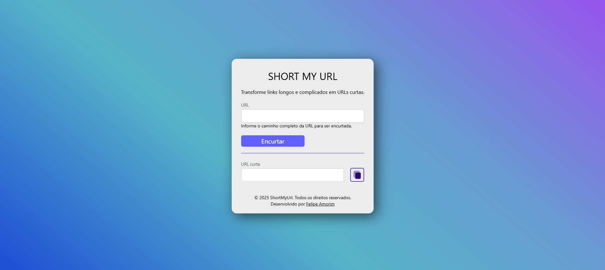

<p align="center"></p>

<h1 align="center">🔗 ShortMyUrl Web</h1>

<p align="center"><em>Angular interface for creating short links.</em></p>

<p align="center">🇧🇷 <a href="README.md">Português</a> | 🇺🇸 English</p>

<p align="center"> </p>

<p align="center"><a href="#sobre">About</a> • <a href="#tecnologias">Technologies</a> • <a href="#como-rodar">Running locally</a> • <a href="#licenca">License</a> • <a href="#autor">Author</a></p>

---

<a id="sobre"></a>
## 📖 About

Angular 19 and Tailwind CSS 4 frontend for the ShortMyUrl shortening service.

## ✨ Features

- Short URL creation interface
- ShortMyUrl API integration

## 🛠️ Technologies

   

## 📦 Prerequisites

Node.js and npm compatible with the Angular version used by this project.

<a id="como-rodar"></a>
## 🚀 Running locally

```bash
git clone https://github.com/Felipe-Amorim-Dev/ShortMyUrl-Web.git
cd ShortMyUrl-Web
npm ci
npm start
```

http://localhost:4200

## 🔗 Related repositories

- [ShortMyUrl-DOTNET](https://github.com/Felipe-Amorim-Dev/ShortMyUrl-DOTNET) — Serviço de encurtamento .NET

## 🏗️ Architecture and responsibilities

- AppComponent handles form inputs, original and short URLs, and clipboard copying.
- UrlService encapsulates POST requests through HttpClient.
- src/environment/environment.ts sets the backend URL.

### Execution flow

1. Form → AppComponent.onSubmit() → UrlService.encurtar() → .NET API → MongoDB.
2. Response data updates urlNova; copiarUrl uses navigator.clipboard.writeText().
3. takeUntil and ngOnDestroy close the RxJS subscription.

### Local execution

```bash
npm ci
npm start
```

Project endpoint: http://localhost:4200

<a id="licenca"></a>
## 📄 License

Distributed under the [MIT license](LICENSE).

<a id="autor"></a>
## 👤 Author

**Felipe Figueiredo Amorim** — Full Stack Developer.

[](https://www.linkedin.com/in/felipe-amorim-dev/) [](mailto:felipe.f.amorim@outlook.com)

<p align="center"><strong>Obrigado por visitar! / Thanks for visiting!</strong></p>
